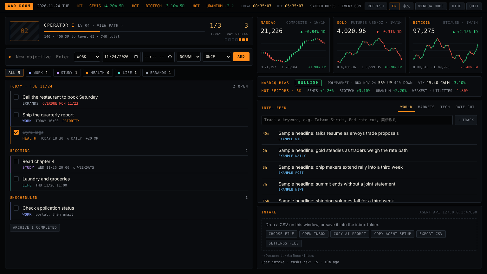

# War Room

A desktop control panel for your day. Tasks on the left, the world on the right.

- **Tasks with levels.** Finish tasks, earn XP, climb ranks. Streaks, priorities, repeating tasks, due-time notifications.
- **CSV in, from any AI.** Drop a CSV on the window or into an inbox folder and the tasks appear. One button copies a prompt that makes any chat AI output the right format.
- **Agent API.** A local, token-protected HTTP API so an AI agent can read, add and complete tasks.
- **Markets.** A scrolling tape, three one-week hourly candle charts, the hottest sectors of the last five days, and a Nasdaq bull/bear read from Polymarket odds and the VIX.
- **News by keyword.** Track any phrase as its own tab. English or Chinese sources.
- **Your path.** Add your own images, one per rank. Each unlocks as you level up.
- **Desktop mode.** Frameless, full screen above the taskbar, no taskbar button, global hotkey.

Everything is stored on your computer. No account, no API keys, no telemetry.

## Install

**Download:** grab the installer for your system from the Releases page.

**Or build it yourself** (needs [Node.js](https://nodejs.org) LTS):

    git clone <this repo>
    cd war-room
    npm install
    npm start          # run it
    npm run dist       # build an app folder into dist/

Windows users can double-click `setup-windows.bat`, Mac users `setup-mac.command`: they install, build and start the app.

## Tasks

Add one with the top-left form, or import many:

| column | required | values |
|---|---|---|
| `title` | yes | anything |
| `category` | | a category id, label or keyword from your settings |
| `due` | | `YYYY-MM-DD`, `MM/DD`, `today`, `tomorrow` |
| `time` | | `HH:MM` or `6:30pm` |
| `priority` | | `high`, `medium`, `low` |
| `repeat` | | `daily`, `weekdays`, `weekly`, `monthly` |
| `notes` | | anything |

Chinese headers (`任务, 分类, 日期, 时间, 优先级, 重复, 备注`) work too. A task with the same title and date as an existing one is skipped. Try `sample-tasks.csv`.

Three ways in:
1. Drop the file on the window, or press CHOOSE FILE.
2. Save it into `Documents/WarRoom/inbox`. It is imported and moved to `inbox/imported`.
3. The agent API (below).

Double-click a title to rename it. `+1D` moves a task to tomorrow. Completing a repeating task schedules the next one. EXPORT CSV saves everything.

## Levels

High priority = 30 XP, normal 20, low 10. Level *n* needs 100 × *n* XP. A new rank every 3 levels. Unchecking a task takes the XP back.

Click the operator panel to open the path. Put your own images in `Documents/WarRoom/path` as `stage-1.jpg`, `stage-2.jpg` … (jpg, png or webp), one per rank. Until you do, numbered placeholders are shown.

## Settings

Everything personal lives in `Documents/WarRoom/config.json` (SETTINGS FILE button, or the tray menu). Save the file and the app reloads it.

| key | what it controls |
|---|---|
| `categories` | id, label, color and import keywords for each task category |
| `ranks`, `levelsPerStage`, `xp` | rank names, how many levels per rank, XP per priority |
| `tape` | `[label, symbol]` rows for the scrolling tape (Yahoo Finance symbols) |
| `charts` | up to three candle charts |
| `sectors` | ETFs ranked for HOT SECTORS |
| `topics` | default news tabs for `en` and `zh` |
| `bias` | show or hide the NASDAQ BIAS strip |
| `refreshMinutes` | how often markets and news refresh (default 60) |
| `notify` | desktop notification when a task's time arrives |
| `hotkey`, `agentPort` | global show/hide shortcut and API port (restart to apply) |

If the file has a JSON mistake the app says so and runs on defaults.

## Agent API

Local only (`127.0.0.1`), and every request needs the token. COPY AGENT SETUP puts the endpoints and your token on the clipboard, ready to hand to an agent.

    GET    /tasks              list tasks, level, XP
    POST   /tasks              JSON task or array of tasks
    POST   /import             CSV text
    POST   /tasks/{id}/done    complete a task
    DELETE /tasks/{id}         remove a task

    curl -H "Authorization: Bearer <token>" -H "Content-Type: application/json" \
         -d '{"title":"Review PR","category":"work","due":"today","priority":"high"}' \
         http://127.0.0.1:47600/tasks

Agents without HTTP access can simply write a CSV into the inbox folder.

## Desktop mode

On by default. The window has no frame, fills the screen above the taskbar and has no taskbar button.
`Ctrl+Alt+W` shows or hides it from anywhere; the tray icon does the same and holds Quit and "Start with the computer". WINDOW MODE in the top bar switches to a normal window.

It is a real window, not a wallpaper layer: Win+D hides it, and clicking it brings it in front of other windows.

## Data sources and limits

- Quotes: Yahoo Finance's public chart endpoint (unofficial), CoinGecko as backup for bitcoin.
- Headlines: Google News RSS search.
- Nasdaq odds: Polymarket's daily "Nasdaq 100 up or down" market.

No keys are needed, but none of these is a guaranteed service. If one changes or is unreachable, that block shows "no data" and the rest keeps working. Check each provider's terms before using their data for anything beyond personal use.

NASDAQ BIAS is a rule of thumb (55%+ implied odds of an up day = BULLISH, 45% or less = BEARISH; VIX level shown alongside), drawn from a small market. **Nothing in this app is financial advice.**

## Project layout

    main.js          window modes, tray, hotkey, notifications, folder watchers, agent API server
    preload.js       the only bridge between the interface and the system
    lib/config.js    defaults and loading of config.json
    lib/store.js     tasks, CSV import/export, recurrence, XP
    lib/feeds.js     quotes, sectors, Polymarket, news
    lib/api.js       agent API routes
    app/             the interface (plain HTML, CSS, JS; no framework, no bundler)
    test.js          npm test

The interface runs sandboxed with context isolation; it can only reach the system through the calls in `preload.js`.

## Releasing

Push a tag (`git tag v2.0.0 && git push origin v2.0.0`). GitHub Actions builds Windows, macOS and Linux packages and attaches them to a release. Builds are unsigned, so Windows SmartScreen and macOS Gatekeeper will warn on first launch.

## License

MIT
